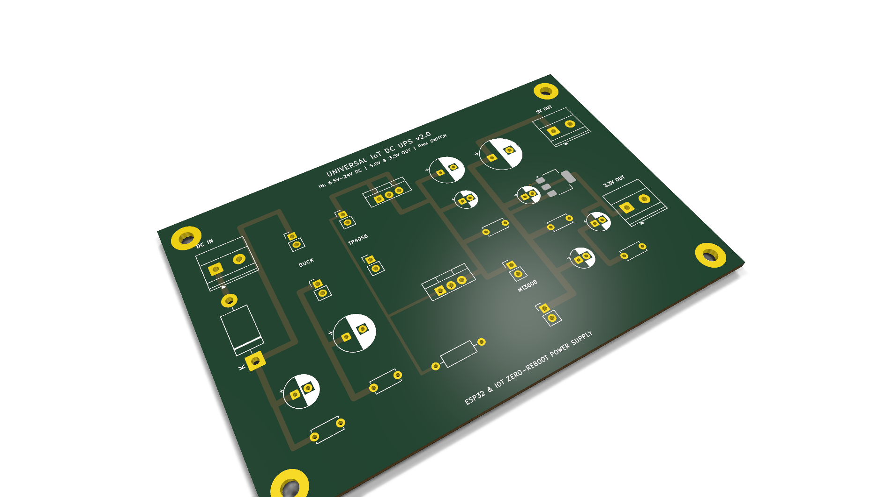
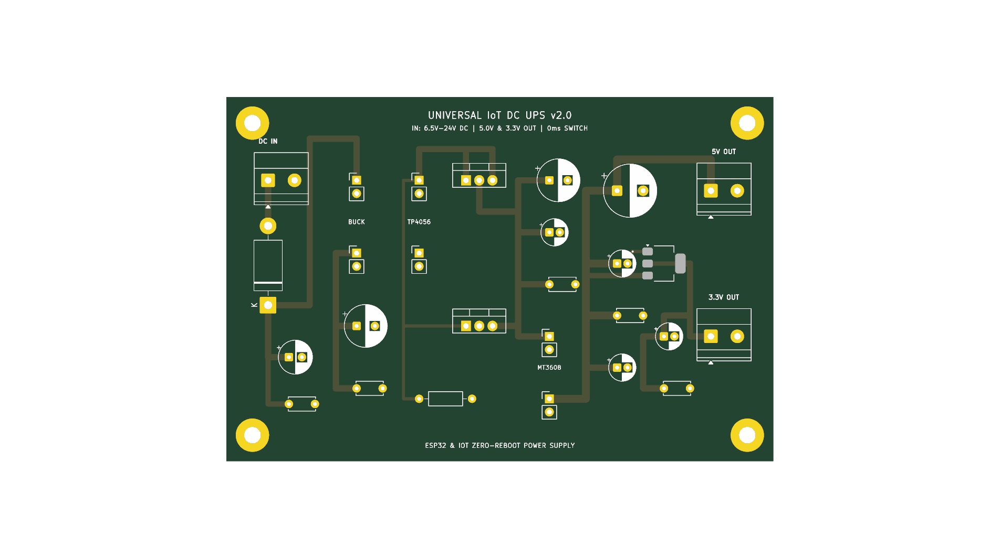

# esp32-dc-ups

> **Zero-Reboot DC UPS for ESP32 & IoT — Seamless 0ms power-path switching, wide DC input (6.5V–24V), 1S Li-ion battery backup, and dual regulated 5.0V & 3.3V outputs in KiCad.**

[](https://www.kicad.org/)
[]()
[]()
[]()
[](LICENSE)

An industrial-grade, ultra-low-cost, uninterruptible power supply (DC UPS) module designed from the ground up to prevent brownout crashes and reboot loops on ESP32, ESP8266, Raspberry Pi Pico, and sensitive IoT sensor nodes. Designed in **KiCad 10** with 100% verified Design Rule Checks (DRC) and Electrical Rule Checks (ERC).

---

## 3D Hardware Previews

| Isometric View | Top View |
| :---: | :---: |
|  |  |

---

## Why esp32-dc-ups?

Most DIY IoT backup solutions connect a single 18650 lithium battery directly to an ESP32's `VIN` or rely on simple diode-ORing circuits. In production deployments, this leads to two major failure modes:

### 1. The "AMS1117 LDO Dropout Trap"
Over 90% of budget ESP32 development boards (NodeMCU-32S, ESP32-WROOM DevKit) use the **AMS1117-3.3** linear regulator, which has a dropout voltage ($V_{drop}$) of **$1.1\text{V} - 1.3\text{V}$** under typical Wi-Fi transmission bursts ($300\text{mA} - 500\text{mA}$):
$$V_{IN(min)} = 3.3\text{V} + 1.1\text{V} = 4.4\text{V}$$
* A standard single-cell Li-ion battery discharges from **$4.2\text{V} \rightarrow 3.0\text{V}$** (nominal $3.7\text{V}$).
* When battery voltage dips below $4.0\text{V}$, the AMS1117's output drops below $2.8\text{V}$, instantly tripping the ESP32 internal brownout detector (BOD) and causing infinite reboot loops.

### 2. Li-ion Charger Never Terminates
Powering an active IoT microcontroller directly across a charging TP4056 module causes continuous load current ($>70\text{mA}$) to draw through the battery pins. The TP4056 never detects the $C/10$ termination threshold, causing perpetual float charging, battery swelling, plating, and thermal hazards.

### The Solution: True 3-Stage Isolated Power-Path

| Feature | Standard USB / Diode ORing | Commercial Power Banks | **esp32-dc-ups (This Project)** |
| :--- | :---: | :---: | :---: |
| **Switchover Delay** | $>10\text{ms}$ (Reboots ESP) | $50\text{ms} - 200\text{ms}$ (Full Reboot) | **$0\text{ms}$ (Zero Delay, Anti-Reboot)** |
| **Input Voltage Range** | $5.0\text{V} \pm 5\%$ only | $5.0\text{V}$ only | **$6.5\text{V} - 24.0\text{V}$ Wide DC** |
| **Reverse Polarity Protection** | Rare / None | Fuse / None | **1N5822 3A Schottky Protected** |
| **Li-ion Termination ($C/10$)** | Broken (Continuous load) | Internal BMS | **Fully Isolated (Load never touches battery during mains)** |
| **Dual Regulated Rails** | No | 5V only | **5.0V (Boost 2A) + 3.3V (LDO) on Screw Terminals** |
| **Build Cost** | BDT 300 | BDT 1,200 – 1,800 | **BDT 430 – 490 (~$4 USD)** |

---

## Key Features

1. **Wide DC Input Stage (6.5V – 24V):**
   - High-current 5.08mm screw terminal (`J1`).
   - Integrated reverse-polarity protection via **1N5822 (3A / 40V Schottky)**.
   - Dual-stage input filter with high-frequency decoupling ($100\mu\text{F} / 35\text{V} + 100\text{nF}$).
   - Steps down any standard adapter ($7.5\text{V}, 9\text{V}, 12\text{V}, 15\text{V}, 19\text{V}, 24\text{V}$) to a clean $5.0\text{V}$ bus via high-efficiency Buck converter headers.

2. **Isolated Safe Charging (TP4056 + DW01A):**
   - System load is completely isolated from the battery charging circuit during mains operation.
   - TP4056 properly reaches its $C/10$ charge cut-off ($4.20\text{V} \pm 1\%$), maximizing cell cycle life.
   - Compatible with any 1S $3.7\text{V}$ 18650 cylindrical cell or Li-Po pouch battery.

3. **Sub-Millisecond Zero-Delay Power-Path Switching:**
   - Active P-Channel MOSFET (**NDP6020P / AO3401**) + Ultra-Fast Dual Schottky Barrier Diode (**MBR460CT**).
   - $10\text{k}\Omega$ pull-down resistor ensures instantaneous gate turn-on when mains voltage drops.
   - Switched intermediate bus backed by a low-ESR bulk capacitance matrix ($220\mu\text{F} + 10\mu\text{F} + 100\text{nF}$) for **$0\text{ms}$ cutover transition**.

4. **Synchronous Dual Regulated Outputs:**
   - **5.0V Rail:** Regulated via MT3608 high-frequency boost converter with a massive **$1000\mu\text{F} / 25\text{V}$ reservoir capacitor** to easily absorb ESP32 Wi-Fi TX current spikes ($>450\text{mA}$).
   - **3.3V Rail:** Dedicated onboard **AMS1117-3.3** linear regulator with thermal via array connecting directly to the bottom solid ground plane.
   - Both rails terminate on dedicated 5.08mm Phoenix-compatible screw terminals.

---

## System Architecture

```
[DC IN 6.5V-24V] ──> [1N5822 Schottky] ──> [Input Buck Module] ──> [+5V_IN Bus]
  (Screw Term J1)      (Reverse Protect)      (Steps down to 5.0V)        │
                                                                         ├──> [TP4056 + DW01A] ──> [1S Li-ion Battery]
                                                                         │       (Isolated Charge)          │
                                                                         │                                  │
[MT3608 Boost 5.1V] <── [Zero-Delay P-MOSFET + MBR460CT Power-Path] <────┴──────────────────────────────────┘
        │
        ├───> [1000uF Reservoir Cap] ───> [5.0V OUT Screw Terminal (J6)]
        │
        └───> [AMS1117-3.3 LDO] ────────> [3.3V OUT Screw Terminal (J7)]
```

---

## Hardware Specifications

| Parameter | Specification | Note |
| :--- | :--- | :--- |
| **Input Voltage Range** | $6.5\text{V} - 24.0\text{V}$ DC | Compatible with 9V/12V/19V/24V adapters |
| **Backup Battery** | Single-cell Li-ion / Li-Po ($3.7\text{V}$ nom, $4.2\text{V}$ max) | 18650, 21700, or flat pouch cell |
| **Output 1 (5V Rail)** | $5.0\text{V} \pm 2\%$ @ up to $2.0\text{A}$ | Primary supply for dev kits, sensors, relays |
| **Output 2 (3.3V Rail)** | $3.3\text{V} \pm 1.5\%$ @ up to $800\text{mA}$ | Direct clean rail for ESP32 SoC, sensors |
| **Cutover Transition Delay** | **$< 0.1\text{ms}$ (Effectively 0ms)** | Microcontroller brownout risk: **0%** |
| **PCB Dimensions** | $105\text{mm} \times 70\text{mm}$ | 2-layer FR4, $1.6\text{mm}$ thickness, 1oz Cu |
| **Mounting Holes** | $4\times \text{M3}$ ($3.2\text{mm}$) | Grounded rings with thermal relief |
| **Terminals** | $3\times 5.08\text{mm}$ 2-Pin Screw Terminals | Phoenix MKDS-1,5/2-5.08 compatible |

---

## Pinout & Terminal Mapping

### Screw Terminals
* **`J1 (DC IN)`**:
  - `Pin 1 (+)`: DC Input Positive ($+6.5\text{V} - 24\text{V}$)
  - `Pin 2 (-)`: System Common Ground (`GND`)
* **`J6 (5V OUT)`**:
  - `Pin 1 (+)`: Regulated $+5.0\text{V}$ Output
  - `Pin 2 (-)`: System Common Ground (`GND`)
* **`J7 (3.3V OUT)`**:
  - `Pin 1 (+)`: Regulated $+3.3\text{V}$ Output
  - `Pin 2 (-)`: System Common Ground (`GND`)

### Module Header Interfaces (2.54mm Pitch)
* **`J_B_IN`**: To Step-Down Buck Converter Input (`Pin 1: +VIN_FILT`, `Pin 2: GND`)
* **`J_B_OUT`**: From Step-Down Buck Converter Output (`Pin 1: +5V_IN`, `Pin 2: GND`)
* **`J2`**: To TP4056 Charger Input (`Pin 1: +5V_IN`, `Pin 2: GND`)
* **`J3`**: From TP4056 / Battery Protection Board Output (`Pin 1: V_BAT_PROT`, `Pin 2: GND`)
* **`J4`**: To MT3608 Boost Converter Input (`Pin 1: V_SW`, `Pin 2: GND`)
* **`J5`**: From MT3608 Boost Converter Output (`Pin 1: +5V_OUT`, `Pin 2: GND`)

---

## Bill of Materials (BOM) & Budget Analysis

All components were intentionally selected for ready availability in local electronics markets (Dhaka Patuatuli / Elephant Road, TechShopBD, RoboticsBD, Daraz BD):

| Item | Component | Package / Rating | Qty | Est. Cost (BDT) | Purpose |
| :---: | :--- | :--- | :---: | :---: | :--- |
| 1 | **Buck Converter Module** | Mini-360 / LM2596 / MP1584 | 1 | ৳ 45 – 65 | Steps down 6.5V–24V to 5V |
| 2 | **TP4056 Charger Module** | Type-C with DW01A + 8205A | 1 | ৳ 25 – 35 | Safe 1S CC/CV charging with protection |
| 3 | **MT3608 Boost Module** | 2A DC-DC Step-Up | 1 | ৳ 35 – 45 | Regulates switched bus to 5.1V |
| 4 | **MBR460CT / MBR1045** | TO-220 Dual Schottky Diode | 1 | ৳ 20 – 30 | Mains power-path steering |
| 5 | **NDP6020P / AO3401** | TO-220 / SOT-23 P-MOSFET | 1 | ৳ 25 – 35 | Battery power-path switch |
| 6 | **AMS1117-3.3** | SOT-223 Low-Dropout Regulator | 1 | ৳ 10 – 15 | Dedicated 3.3V output rail |
| 7 | **1N5822** | DO-201AD 3A Schottky Diode | 1 | ৳ 8 – 12 | Input reverse polarity protection |
| 8 | **1000uF 25V** | Radial Electrolytic Capacitor | 1 | ৳ 12 – 18 | High-capacity output buffer |
| 9 | **220uF 16V** | Radial Electrolytic Capacitor | 2 | ৳ 10 – 16 | Input & switched bus smoothing |
| 10 | **10uF, 22uF, 100uF** | Radial Capacitors | 4 | ৳ 15 – 20 | LDO & rail decoupling |
| 11 | **100nF (104)** | Multilayer Ceramic Capacitor | 5 | ৳ 5 – 10 | High-frequency noise suppression |
| 12 | **10kΩ Resistor** | 1/4W Through-Hole | 1 | ৳ 1 – 2 | MOSFET gate pull-down |
| 13 | **5.08mm Screw Terminals** | 2-Pin Terminal Blocks | 3 | ৳ 30 – 45 | DC IN, 5V OUT, 3.3V OUT |
| 14 | **2.54mm Pin Headers** | Male / Female strip | 1 | ৳ 10 – 15 | Sub-module interconnects |
| 15 | **Custom 2-Layer PCB** | 105mm × 70mm FR4 | 1 | ৳ 120 – 150 | Local fabrication batch price |
| **Total** | | | | **৳ 371 – 513** | **~$3.50 – $4.80 USD** |

---

## Verification & Design Rule Checks

The project includes verified verification logs generated via the KiCad CLI test suite:

- **Electrical Rules Check (ERC):** Passed with **0 errors, 0 unconnected wires**.
- **Design Rules Check (DRC):** Passed with **0 violations, 0 unconnected pads, 0 footprint errors**.
- **Reports:**
  - Official DRC Report: [`exports/drc_report.rpt`](exports/drc_report.rpt)
  - Official ERC Report: [`exports/erc_report.rpt`](exports/erc_report.rpt)

---

## Repository Structure

```text
esp32-dc-ups/
├── kicad/                             # KiCad 10 project and schematic files
│   ├── DC_UPS_IoT.kicad_pro           # KiCad Project File
│   ├── DC_UPS_IoT.kicad_sch           # Complete Schematic
│   ├── DC_UPS_IoT.kicad_pcb           # 2-Layer PCB Layout
│   └── DC_UPS_IoT.kicad_prl           # Project Local Configuration
│
├── exports/                           # High-resolution production renders & reports
│   ├── DC_UPS_IoT_3d_iso.png          # 3D Isometric Board Render
│   ├── DC_UPS_IoT_3d_top.png          # 3D Top-Down Board Render
│   ├── DC_UPS_IoT.svg                 # Schematic Diagram (Vector SVG)
│   ├── DC_UPS_IoT_pcb.svg             # PCB Copper & Silk (Vector SVG)
│   ├── drc_report.rpt                 # Verified DRC Report (0 violations)
│   └── erc_report.rpt                 # Verified ERC Report (0 errors)
│
├── simulation/                        # Automation & SPICE transient simulation
│   ├── build_pcb.py                   # PCB Generation & Layout Automation
│   ├── build_kicad_project.py         # KiCad Schematic Generation Script
│   ├── simulate_ups.py                # Python/SciPy Transient Cutover Simulation
│   ├── generate_sim_files.py          # LTspice & Falstad Netlist Generator
│   ├── dc_ups_ltspice.cir             # LTspice Circuit Model
│   ├── falstad_circuit.txt            # Falstad Interactive Circuit Data
│   ├── falstad_link.txt               # Direct Falstad Web Simulator Link
│   └── ups_transient_simulation.png   # Transient Waveform Plot
│
├── visual_breadboard_interactive.html # Interactive visual wiring guide
├── .gitignore                         # KiCad temporary & lock file ignore rules
├── LICENSE                            # MIT Open Source License
└── README.md                          # Project Documentation
```

---

## Getting Started in KiCad

1. Clone this repository:
   ```bash
   git clone https://github.com/Masud744/esp32-dc-ups.git
   cd esp32-dc-ups
   ```
2. Open KiCad 8 or KiCad 10.
3. Select **File -> Open Project...** and choose:
   ```text
   kicad/DC_UPS_IoT.kicad_pro
   ```
4. **Interactive 3D Viewer:**
   Open the PCB Editor (`DC_UPS_IoT.kicad_pcb`) and press **`Alt + 3`** to inspect the fully rendered 3D PCB model.

---

## Author

**Shahriar Alom Masud**  
B.Sc. Engg. in IoT & Robotics Engineering  
University of Frontier Technology, Bangladesh  
Email: [masud.nil74@gmail.com](mailto:masud.nil74@gmail.com)  
GitHub: [@Masud744](https://github.com/Masud744) | LinkedIn: [linkedin.com/in/shahriar-alom-masud](https://www.linkedin.com/in/shahriar-alom-masud)

---

## License

This project is open-source hardware licensed under the **MIT License**. See [LICENSE](LICENSE) for full details.
